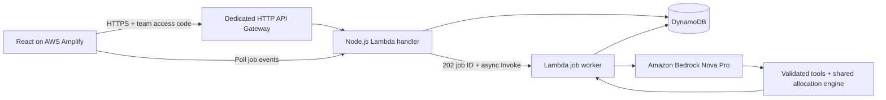

# AWS deployment

The isolated AWS demo runs at https://main.dgblsgkgfm7j6.amplifyapp.com . Its API is https://5ythut6kx6.execute-api.us-east-1.amazonaws.com . A team demo access code is required; it is intentionally not committed or included in frontend assets.

**Team API `AWS25` (`vceh0xmua8`) is separate.** Its FoodTraceAI routes/integration were removed at the owner's request. Deployment and connection scripts refuse to modify that API. Teammates can configure it independently.

## Architecture



The same Lambda deployment handles HTTP requests and IAM-authorized asynchronous work. Requests needing inference return a durable job ID immediately. Polling reconstructs tool events for the existing frontend, avoiding the HTTP API's 30-second integration limit. The original `lib/continuity.ts` arithmetic, `lib/bedrock-continuity.ts` agent, case extraction, and `app/api/` validation are reused. Build adapters replace only Cloudflare environment and persistence modules.

Lambda obtains rotating credentials from its execution role. No pasted workshop credentials are deployed. The role grants access only to this app's table/index, self-invocation, log group and the selected Bedrock model. The browser receives no AWS secrets. The shared demo code is hashed server-side, entered at runtime, and kept in browser session storage. This is a team demo gate, **not individual user accounts or retailer/regulator authorization**.

DynamoDB stores cases, plans, job results, and audit events. Plan creation and approval events are transactional; a conditional write prevents competing approval/rejection decisions. Repeating the same decision is idempotent. Jobs/events expire after approximately 24 hours through TTL; cases/plans/audits persist. The original Sites D1 records are not automatically copied.

## Build and verify

From repository root, with Node 22.13+:

```sh
npm ci --prefix aws
npm ci --prefix frontend
npm run build --prefix aws
npm test --prefix aws
npm test --prefix frontend
```

AWS tests use a mocked transport for authentication, origin restrictions, transactional decisions, shortage acknowledgment, durable case storage and job dispatch. Frontend tests cover job polling and the shared 120-case allocation suite.

## Deploy or reconnect

Use your own authorized AWS CLI environment/session credentials. Never paste credentials into source files, GitHub or `VITE_` variables. Scripts also support hidden terminal input for an authorized automation runner.

```sh
# Creates/reuses the dedicated API and deploys the app. Does not touch team AWS25.
npm run connect:isolated --prefix aws

# Or target an explicitly selected dedicated API with a $default stage:
DEPLOY_API_ID=YOUR_ISOLATED_API_ID npm run deploy --prefix aws

# Runs real paid Bedrock calls and writes clearly fictional test cases/decisions:
npm run test:live --prefix aws
```

The deploy script builds/publishes the frontend through Amplify manual deployment. This is separate from GitHub's optional `amplify.yml` build integration. `aws/.local/deployment.json` records resource IDs. `aws/.local/access.json` contains the demo access code. Both are ignored by Git and must remain private.

The script currently targets `us-east-1`, resource names `supply-continuity-api`, `supply-continuity-data`, `supply-continuity-runtime`, and the configured Amplify app. Do not run multiple copies against those same names for different applications. Use separate resource names/accounts for independent environments. It provisions AWS resources and incurs ordinary usage charges.

## Publish frontend-only updates

Run `npm run publish:frontend --prefix aws` after reviewing a UI change. This rebuilds and publishes the static app using the saved isolated API configuration. It does not modify Lambda, API routes, IAM policies or DynamoDB.

## Pause and resume without deleting data

```sh
npm run connection --prefix aws -- status
npm run connection --prefix aws -- pause
npm run connection --prefix aws -- resume
```

Pause disables the dedicated API's default execute-api endpoint. The frontend then cannot use API functionality. Resume enables the same endpoint again; no route deletion, database reset or frontend rebuild is needed. This control assumes the deployment's default API endpoint (no custom API domain). In-flight jobs may finish after pausing. Pause does not delete infrastructure or stop storage charges. The team API is never modified by these commands.

## Verified live behavior

AWS acceptance verification on October 24, 2026 (Pacific time) passed:

- Anonymous API requests rejected; exact Amplify origin allowed by CORS.
- Customer report saved, then **real Bedrock** extracted its product/lot.
- Exact synthetic lot/store evidence linked; a missing lot stayed `needs_records`.
- Five real Bedrock tool calls generated a stored recovery plan.
- Baseline: **1,220 kg required, 1,220 kg allocated, 0 kg unfilled**.
- Oakland warehouse outage: **1,591 kg required, 611 kg allocated, 980 kg unfilled**. Only independent Petaluma supply was allocated.
- Approval persisted and a repeated approval produced one audit event.

These are demonstration results, not measured illness prevention or guaranteed delivery times. No purchase, inventory reservation, actual hold, notification, or dispatch occurs. Suppliers/inventory/incidents are synthetic; real store locations and modeled road distances are retained. The shortage is surfaced, not hidden.

See [AWS HTTP API quotas](https://docs.aws.amazon.com/apigateway/latest/developerguide/http-api-quotas.html) and [Lambda execution-role credentials](https://docs.aws.amazon.com/lambda/latest/dg/configuration-envvars.html) for the platform constraints behind this design.
