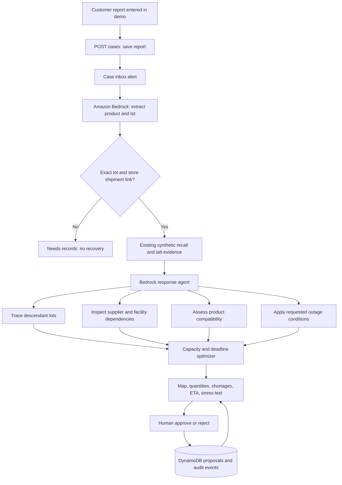

# Architecture and decision boundaries

The model handles unstructured language, product compatibility and requested scenario interpretation. Server code controls source verification, allowed tools, recalled-lot status, facility exclusions, kg normalization, capacity, priorities and the final numerical summary. Every proposal records the model's assessment and a calculation fingerprint. The agent cannot approve a plan or release a hold.

Offers B and D share Oakland facility 5; B also depends on Richmond packer 1. The relationship diagram focuses on Oakland. These are authored scenario edges. A supplier with a separate lot may be eligible during a lot recall, while a confirmed facility closure blocks every offer dependent on that facility. The demo makes no causal inference from proximity or a shared blend alone.

The optimizer uses minimum-cost flow. Dummy shortage edges keep infeasible plans explicit. P0 shortage penalty is higher than P1; continuity mode then penalizes late delivery before modeled pack-minutes. Costs combine synthetic purchase price and $0.04/kg-km transportation. No vehicle capacities, multi-stop schedules or physical reservations are implemented.

27 stores are available: 21 grocery stores and 6 restaurant/fast-food locations. Filters change presentation, not authorization or the regional approval scope. Customer reports only link to stores with a matching shipped lot. Investigations relate to one synthetic incident; this does not generalize arbitrary real reports into a verified recall.

## Persistence

- DynamoDB `CASE`: original report, selected store, extracted fields, model, matching status.
- DynamoDB `PLAN`: scenario, assessments, computed plan, fingerprint, source and decision.
- DynamoDB `EVENT`: timestamped case, tool and review events.
- DynamoDB `JOB` / `JOBEVENT`: asynchronous inference status and browser-pollable tool output; TTL enabled.

The original Sites adapter uses the separate D1 tables `intake_cases`, `recovery_plans` and `workflow_events`. Those are not the deployed AWS storage.

A proposal survives refresh in storage. The initial visual plan resets to the catalog scenario on reload; the timeline and case inbox retain prior activity. Approval is a reviewed proposal, not a stock reservation. The system must be connected to atomic inventory reservation and real authorization before operational use.

## Estimated timing

All durations start after assumed approval. Delivery ETA includes fixed supplier preparation plus baseline road time times the scenario traffic factor. Full supply recovery adds 30 minutes for receiving verification; it is not provided when demand remains unfilled. Neither value predicts official incident closure or lab clearance.

## Infrastructure

The current web frontend is React/Vite on AWS Amplify. A dedicated API Gateway invokes Lambda, which stores application state in DynamoDB and invokes Bedrock using its execution role. Inference is queued to an asynchronous Lambda invocation and polled by the browser. The original Sites/Cloudflare/D1 runtime is a separate earlier deployment. This demo does not use a live RDS connection, AWS-managed Agents for Bedrock, or a Knowledge Base. Do not draw these as implemented services in the video.

## Same-chain store recovery

Opt-in transfer edges add same-chain retail stores as sources in the same flow graph. Only exact-product released/unexpired lots with verified cold chain and mock transfer approval qualify. Store-level source capacity protects reservations plus target days of cover across all its lot nodes. Current recipients cannot donate; inbound/new allocations are never re-exported. Directional OSRM routes provide distance and modeled ETA; transfers have a 120-minute cap. The UI distinguishes supplier and store quantities. See README for verified snapshot comparisons.

## Incident priority policy

`GET /api/continuity` returns an evidence-derived regional incident queue. Closed records sort last; active recalls or positive lot tests are P0; investigating or pending-lab incidents are P1; other open records are P2. Ties sort by flagged inbound quantity descending, then report time ascending. The queue is a synthetic operational policy, not a clinical prediction, regulator classification, or an AI confidence score.

The active incident card adds the current plan's remaining supply shortage and next action. A checklist acknowledgment, approval, or modeled delivery cannot clear the incident. E02 and E03 are evidence-only records; recovery allocation is implemented for E01. Store-level P0/P1 deadlines are a separate, explicitly illustrative replenishment policy.
