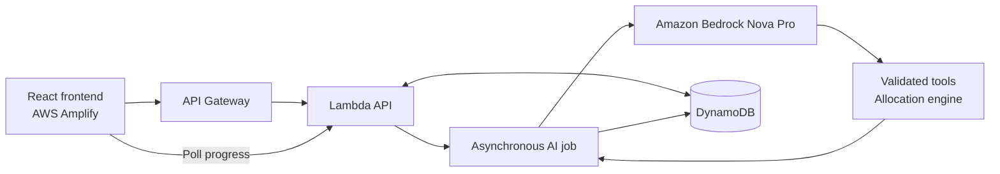

# Five-minute demo video: FoodTraceAI

> **Current v3 recording path:** Start at the main dashboard → Raw Chicken → New incident → Fill example report → Submit & analyze new incident → Record reviewed evidence & demo hold → Run recovery agent (600-unit limit) → Run recovery agent (1,000-unit limit) → inspect Agent self-review, road distances and allocation map → acknowledge shortage → Approve demo proposal. The main KPI cards update after each saved result. Switch Romaine / Raw Chicken / Tomatoes to demonstrate incident isolation. Old instructions below referring to a separate Recovery demo or New incident workspace are historical. Self-review adds one Bedrock call per plan; allow processing time. Read actual returned figures, not a prewritten guarantee.

The product now emphasizes the incident, the recovery map, supplier quantities, and the decision. Use narration and one architecture slide for the deeper explanations below. Do not read every dashboard label aloud.

## Recording sequence

| Time | Show | Suggested English narration |
| --- | --- | --- |
| 0:00–0:25 | Incident response, P0 recall, quantities at risk | “Meet Maya, a regional grocery replenishment manager in the Bay Area. A recalled lot interrupts food supply across 18 stores. She needs to contain the affected stock and find eligible replacement supply before stores run short.” |
| 0:25–1:05 | Open **Start with a customer report**, submit the fictional report, wait for **Evidence linked** | “A new report is saved before analysis. Amazon Bedrock extracts the product and lot. Our code checks that the lot actually appears in the report and was shipped to this store. A complaint alone is not proof of contamination.” |
| 1:05–1:55 | **Trace & find replacements**, live agent activity | “Bedrock verifies the supplied recall reference, inspects shared dependencies, evaluates product compatibility and applies the requested constraints. It then calls our allocation engine. The model interprets the situation; validated tools enforce eligibility and calculate quantities.” |
| 1:55–2:30 | Map: **Original supply → Interrupted → Recovery**, supplier allocation buttons, one store row | “The interruption is visible from supplier to store. The recovery plan splits replacement quantities across Napa, Petaluma and Gilroy. For this verified run, 1,220 kilograms are allocated. The dashboard also shows late deliveries and estimated supply recovery.” |
| 2:30–3:15 | **What if Oakland closes?**, wait for the new plan, then **Use same-chain stores** → **See Before / After** | “Different suppliers can share the same failure point. Napa and Gilroy both depend on Oakland. Closing that facility removes both options. Independent Petaluma can supply 611 kilograms; 980 remain unfilled. Ask the agent to use same-chain stores: 116 additional kilograms reduce that gap to 864, while protecting each donor’s own stock. The remaining shortage stays visible.” |
| 3:15–3:45 | **Review & approve plan**, acknowledge the shortage, save a demo decision; show timeline | “The manager reviews a specific saved plan. A shortage requires explicit acknowledgment. The server checks the plan fingerprint, saves the decision and records an audit event. Approval here is a demo decision, not a real shipment.” |
| 3:45–4:20 | Architecture slide below | “The React frontend runs on AWS Amplify. API Gateway invokes Lambda. Longer AI operations run as asynchronous jobs so the browser can display progress without waiting on a single gateway request. Bedrock Nova Pro performs the AI work, and DynamoDB persists reports, plans and decisions.” |
| 4:20–4:45 | Return to the recovery map and unresolved-demand indicator | “The same supplier relationships, capacity limits and delivery constraints can support other disruption scenarios, such as a warehouse outage or a supplier becoming unavailable. Food contamination is our demonstrated scenario; broader disaster response requires the corresponding live operational data.” |
| 4:45–5:00 | Team title and organizer-approved contact channel | “FoodTraceAI helps a replenishment manager understand the impact, compare replacements and make an auditable recovery decision.” Add the actual team contact details before recording. |

Before recording, start with store transfers disabled so the supplier-only quantities above match. Enable them during the warehouse-outage segment. If using edited footage, label any shortened AI wait honestly. For a baseline transfer comparison instead, enable transfers with no outage: six stores contribute 336 kg, suppliers contribute 884 kg, and modeled recovery drops from 215 to 186 minutes. Narrate the actual quantities displayed by your recorded run.

## Before / After recording moment

After **What if Oakland closes?** completes, click **Use same-chain stores** and wait for all five tools. Click **See Before / After** in the agent card. The comparison captures the plan displayed immediately before this run, rather than a hard-coded initial baseline.

Show **Same-chain store transfers: Disabled → Enabled**, **0 → 116 kg** transferred, and **980 → 864 kg** unfilled. Expand **Where did the allocation change?** to show the contributing stores. Narrate: “Bedrock turns the request into a supported constraint change. The allocation engine computes the quantities while protecting donor stock. We recover another 116 kilograms, and the remaining shortage still requires escalation.”

The panel compares the entire regional plan even when the map has a chain filter. A new run or a manual scenario calculation clears the old comparison; an unsuccessful AI run cannot create one. No condition changes are invented when the applied scenario is unchanged. Cost and timing remain modeled; the panel warns when demand changes between scenarios. Export plan includes both snapshots and completed tool evidence. Refreshing clears this session comparison.

## Architecture slide

## Explanations moved out of the main screen

- **Product reasoning:** Bedrock assesses replacement compatibility. The deterministic engine separately enforces recalled-lot exclusions, closed facilities, remaining supplier capacity and required product variety. A 500 g pack is converted to equivalent kilograms.
- **Dependency reasoning:** Shared facilities imply a shared operational vulnerability. Sharing a facility or blended lot is not, by itself, evidence that a second supplier caused contamination.
- **Priority:** The demo policy puts an active recall/positive lot evidence ahead of investigations and closed incidents. Delivery priorities are separate from incident triage. Expand **Incident queue** if asked.
- **Same-chain recovery:** On-hand released lots at other stores can participate in the same allocation graph. Chain equality alone does not guarantee selection: lot/cold-chain eligibility, mock agreement, donor cover, directional road ETA and the selected objective all matter. Donor capacities are shared across recipients; disrupted stores cannot donate. Store-to-store transfers bypass the closed warehouse because that stock is already on hand, not because it has been declared safe by an LLM.
- **Allocation objective:** The model interprets requested conditions; the engine applies the implemented allocation policy. This demo does not establish a globally optimal fleet route or guarantee a delivery time.
- **Timing:** Supply recovery combines modeled preparation/travel with a 30-minute receiving assumption. Unfilled demand means full recovery cannot yet be estimated. Delivery completion does not close an official recall.
- **Resilience:** The extra supplier-failure comparison and single-supplier baseline remain under **Scenario controls**. Show them only if there is time.
- **Audit and approval:** Conditional, transactional database writes prevent competing terminal decisions and duplicate approval events. Approval applies to the regional plan, even when the map is filtered to one chain.
- **Data provenance:** Store locations are real public locations; suppliers, lots, capacity, incidents, stock and deadlines are synthetic. Road distances are modeled OSRM routes between synthetic supplier coordinates and real stores, without live traffic or fleet scheduling.
- **AWS security:** Lambda uses its execution role for Bedrock and DynamoDB. No AWS credential is shipped to the browser. The team code is a demo access gate, not a production account/role system.

## Before recording

Use the live AWS URL, not local simulation. Start with **Recall only** under **Scenario controls** if the previous run closed a warehouse. Record actual tool activity; never present a catalog recalculation as an AI run. Keep the **Synthetic demo** badge visible. Capture the real run's numbers, which may vary with the validated AI product assessment. Reserve the final screen for your actual team name and contact channel.

## Submission evidence still supplied by the team

The team confirmed that Kiro was used; add one truthful sentence naming the work performed with Kiro (for example, only name backend implementation or testing if that is what actually happened). This audit did not independently inspect Kiro history. Add the organizer-approved team contact and verify submission access. The five-minute video itself has not been recorded or reviewed by this audit.

The application aggregates several chains. Explain Maya's regional coordination remit and any chain-specific decision scope; do not imply one retailer can authorize another retailer's inventory. The current views are demo presentations, not tenant authorization. Neither real user research nor real incident outcomes were verified.

## Operational-language extension

The agent now supports region-specific driving-time penalties, one catalog-approved synthetic direct-dispatch lane for D, and supplier spare-stock ceilings. It also reports interpreted assumptions and unapplied requests in the comparison panel.

Example: “There is traffic in the upper Bay Area. Only supplier A has a problem, and we can get supply directly from D.” With Oakland already closed, the intended interpretation is: retain the warehouse closure, block A, assume North Bay travel ×1.5 if no delay was specified, and enable D's approved mock direct lane. B remains dependent on the closed warehouse. A's recalled lot and descendants remain blocked. Product fit is evaluated independently of operational availability so an old outage cannot incorrectly make D's romaine an incompatible product.

The direct lane is a demonstration assumption: D can use its existing 320 kg spare stock with 45-minute preparation and $0.25/kg additional handling. It uses the existing direct-road distance matrix; it does not query a carrier or recompute a road detour. Regional traffic applies when a trip origin or destination is in the selected region, using the maximum applicable multiplier rather than compounding penalties. It does not detect journeys that merely pass through a region.

Follow-up: “North Bay traffic has cleared. D has only 80 kg of uncommitted stock remaining. Keep Oakland closed and preserve direct dispatch.” The agent can clear that regional penalty and cap D at 80 kg. A larger reported stock quantity can never increase the catalog's available inventory.

Unsupported requests such as avoiding Highway 101 specifically, an unknown region, arbitrary milk inventory requirements or external verification must be disclosed under **Not applied** rather than presented as implemented. These are user-supplied what-if conditions, not verified real-time incident facts.

Validation: the original informal request was tested against real Bedrock after separating product-fit assessment from initial route eligibility. An initial attempt incorrectly treated D’s warehouse outage as product incompatibility; that run was not counted as success. The subsequent acceptance sequence passed: D added 320 kg (611 → 931 kg total; 980 → 660 kg unfilled), a follow-up capped D at 80 kg, and unsupported highway/milk constraints were returned as unapplied. Full sanitized results: `verification/operational-language.json`. These observations do not guarantee every paraphrase will be interpreted correctly.

### Recovery coverage: operational action → measurable improvement

In the Recovery agent card, click **Load constrained-stock demo**. This replaces the current scenario with an explicitly synthetic stock report: B has 200 kg spare, D 200 kg, F 332 kg; store transfers are initially disabled. It does not call AI. The engine calculates 732 / 1,220 kg allocated, **60.0% coverage**.

Read or edit the prefilled operations-team request, then click **Run Bedrock investigation**. The request authorizes safe same-chain store transfers, preserves supplier ceilings and donor reserves, and keeps recalled lots excluded. Bedrock interprets this operational permission into a validated scenario change, then calls the allocation engine.

The verified demo result is 1,068 / 1,220 kg, **87.5% coverage (+27.5 percentage points)**. Suppliers still contribute 732 kg; safe store surplus adds 336 kg. There are 152 kg still unfilled and 82 kg allocated after modeled deadlines. On-time coverage improves from 49.6% to 80.8%. Do not call this full recovery, delivered stock, a learned prediction, or 89%. Both plans use the same replacement need.

Narration: “The initial plan covers only 60% of replacement demand. Our operator tells the agent what the team can now do: authorize transfers of safe stock within each retail chain. Bedrock turns that instruction into an executable constraint change. The optimizer protects donor reserves and recalled-lot exclusions, and calculates 87.5% coverage. We can see exactly which stores contribute the additional 336 kilograms, and the remaining shortage is still visible.”

The gain comes from a newly permitted operational action. A manually configured optimizer can also execute that action; the agent's contribution is interpreting the operator's language, applying supported conditions, calling verification tools, and generating an auditable revised plan. See `docs/verification/coverage-demo.json` for the real Bedrock acceptance result. Reload resets the working scenario and comparison; export the plan to preserve the comparison.

### New report → independent incident (v2)

Use **New incident workspace**, choose the chicken example, and submit it. Show the new incident ID and real Bedrock extraction. Record a **synthetic precautionary hold** with a reference; explicitly say this is a demonstration of operator evidence review, not a diagnosis from a complaint. Run the recovery agent and show the chicken-specific source, affected stores, allocations and remaining shortage. Approve the proposal, then refresh to prove persistence. The full live dataset test calculated 1,022 / 1,022 chicken packs before a stock reduction; an unrelated newly registered tomato lot generated its own 95 / 95 pack plan. These outcomes reflect the tested stock revision and can change after operator updates.

Narration: “This is a new report, not a replay of our original romaine recall. Bedrock extracts the lot, the backend validates its provenance, and an operator reviews the evidence. The planner uses that product’s current database stock to produce a traceable recovery proposal. Unknown records stay pending instead of being fabricated, and a stock change invalidates an older proposal.”

Current network/version demo additions:
- On the chosen incident, show Original supply → Interrupted → Recovery. Explain dashed ancestry versus solid proposed allocation lines; show the supplier pack total and click a delivery line for road km/ETA.
- Keep one incident selected for the numerical before/after. Use the synthetic Chicken integration case for the tested 600 → 1,000 pack example (58.7% → 97.8%, 22 packs unresolved).
- Open Plan versions, preview the earlier 600-pack calculation, and explain that viewing history does not apply it. “Use V… as starting point” creates a new branch on the next agent run; it never overwrites that saved calculation.
- The Romaine investigation and 95-pack newly registered Tomato lot have different scopes. Do not describe every product as having 27 affected stores or claim automatic recovery before a proposal exists.
- State that the second Bedrock review is a bounded request/plan consistency check. It may correct a supported condition once, or request clarification; it is not model training, guaranteed improvement, or unlimited self-reflection.
