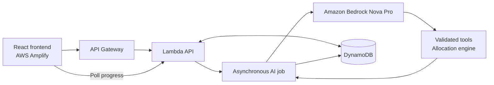

# Five-minute demo video: FoodTraceAI

The product now emphasizes the incident, the recovery map, supplier quantities, and the decision. Use narration and one architecture slide for the deeper explanations below. Do not read every dashboard label aloud.

## Recording sequence

| Time | Show | Suggested English narration |
| --- | --- | --- |
| 0:00–0:25 | Incident response, P0 recall, quantities at risk | “Meet Maya, a regional grocery replenishment manager in the Bay Area. A recalled lot interrupts food supply across 18 stores. She needs to contain the affected stock and find eligible replacement supply before stores run short.” |
| 0:25–1:05 | Open **Start with a customer report**, submit the fictional report, wait for **Evidence linked** | “A new report is saved before analysis. Amazon Bedrock extracts the product and lot. Our code checks that the lot actually appears in the report and was shipped to this store. A complaint alone is not proof of contamination.” |
| 1:05–1:55 | **Trace & find replacements**, live agent activity | “Bedrock verifies the supplied recall reference, inspects shared dependencies, evaluates product compatibility and applies the requested constraints. It then calls our allocation engine. The model interprets the situation; validated tools enforce eligibility and calculate quantities.” |
| 1:55–2:30 | Map: **Original supply → Interrupted → Recovery**, supplier allocation buttons, one store row | “The interruption is visible from supplier to store. The recovery plan splits replacement quantities across Napa, Petaluma and Gilroy. For this verified run, 1,220 kilograms are allocated. The dashboard also shows late deliveries and estimated supply recovery.” |
| 2:30–3:15 | **What if Oakland closes?**, wait for the new plan, then **Use same-chain stores** and show a transfer quantity | “Different suppliers can share the same failure point. Napa and Gilroy both depend on Oakland. Closing that facility removes both options. Independent Petaluma can supply 611 kilograms; 980 remain unfilled. Ask the agent to use same-chain stores: 116 additional kilograms reduce that gap to 864, while protecting each donor’s own stock. The remaining shortage stays visible.” |
| 3:15–3:45 | **Review & approve plan**, acknowledge the shortage, save a demo decision; show timeline | “The manager reviews a specific saved plan. A shortage requires explicit acknowledgment. The server checks the plan fingerprint, saves the decision and records an audit event. Approval here is a demo decision, not a real shipment.” |
| 3:45–4:20 | Architecture slide below | “The React frontend runs on AWS Amplify. API Gateway invokes Lambda. Longer AI operations run as asynchronous jobs so the browser can display progress without waiting on a single gateway request. Bedrock Nova Pro performs the AI work, and DynamoDB persists reports, plans and decisions.” |
| 4:20–4:45 | Return to the recovery map and unresolved-demand indicator | “The same supplier relationships, capacity limits and delivery constraints can support other disruption scenarios, such as a warehouse outage or a supplier becoming unavailable. Food contamination is our demonstrated scenario; broader disaster response requires the corresponding live operational data.” |
| 4:45–5:00 | Team title and organizer-approved contact channel | “FoodTraceAI helps a replenishment manager understand the impact, compare replacements and make an auditable recovery decision.” Add the actual team contact details before recording. |

Before recording, start with store transfers disabled so the supplier-only quantities above match. Enable them during the warehouse-outage segment. If using edited footage, label any shortened AI wait honestly. For a baseline transfer comparison instead, enable transfers with no outage: six stores contribute 336 kg, suppliers contribute 884 kg, and modeled recovery drops from 215 to 186 minutes. Narrate the actual quantities displayed by your recorded run.

## Architecture slide

## Explanations moved out of the main screen

- **Product reasoning:** Bedrock assesses replacement compatibility. The deterministic engine separately enforces recalled-lot exclusions, closed facilities, remaining supplier capacity and required product variety. A 500 g pack is converted to equivalent kilograms.
- **Dependency reasoning:** Shared facilities imply a shared operational vulnerability. Sharing a facility or blended lot is not, by itself, evidence that a second supplier caused contamination.
- **Priority:** The demo policy puts an active recall/positive lot evidence ahead of investigations and closed incidents. Delivery priorities are separate from incident triage. Expand **Incident queue** if asked.
- **Same-chain recovery:** On-hand released lots at other stores can participate in the same allocation graph. Chain equality alone does not guarantee selection: lot/cold-chain eligibility, mock agreement, donor cover, directional road ETA and the selected objective all matter. Donor capacities are shared across recipients; disrupted stores cannot donate. Store-to-store transfers bypass the closed warehouse because that stock is already on hand, not because it has been declared safe by an LLM.
- **Allocation objective:** The model interprets requested conditions; the engine applies the implemented allocation policy. This demo does not establish a globally optimal fleet route or guarantee a delivery time.
- **Timing:** Supply recovery combines modeled preparation/travel with a 30-minute receiving assumption. Unfilled demand means full recovery cannot yet be estimated. Delivery completion does not close an official recall.
- **Resilience:** The extra supplier-failure comparison and single-supplier baseline remain under **Scenario controls**. Show them only if there is time.
- **Audit and approval:** Conditional, transactional database writes prevent competing terminal decisions and duplicate approval events. Approval applies to the regional plan, even when the map is filtered to one chain.
- **Data provenance:** Store locations are real public locations; suppliers, lots, capacity, incidents, stock and deadlines are synthetic. Road distances are modeled OSRM routes between synthetic supplier coordinates and real stores, without live traffic or fleet scheduling.
- **AWS security:** Lambda uses its execution role for Bedrock and DynamoDB. No AWS credential is shipped to the browser. The team code is a demo access gate, not a production account/role system.

## Before recording

Use the live AWS URL, not local simulation. Start with **Recall only** under **Scenario controls** if the previous run closed a warehouse. Record actual tool activity; never present a catalog recalculation as an AI run. Keep the **Synthetic demo** badge visible. Capture the real run's numbers, which may vary with the validated AI product assessment. Reserve the final screen for your actual team name and contact channel.
